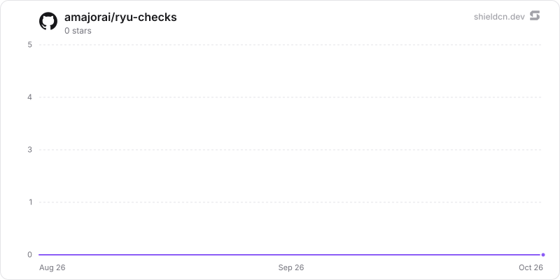

<div align="center">

# checks

</div>

A local-first verification workspace: configure projects, explore features, generate UI/API check plans, review evidence, group suites, and schedule regression checks inside Ryu.

> **The public home of `ryu-checks`.** Source, builds, and releases live here —
> binaries for every platform are attached to each release.
>
> This tree is generated from the Ryu monorepo, so commits pushed here
> directly are replaced on the next sync. **Pull requests are welcome** —
> open them here and they are ported into the monorepo, then flow back out.
> Ryu as a whole: https://github.com/amajorai/ryu

## Install

**App:** [Install](ryu://apps/com.ryu.checks) (opens the Ryu desktop app and asks you to confirm)

**CLI:**

```bash
ryu apps add com.ryu.checks
```

## Source & build

This is the **source of record** for the app UI. It imports Ryu's private
`@ryu/ui` design system, so it does **not** build standalone outside the
monorepo — it **builds inside the amajorai/ryu monorepo workspace**.
The shipped bundle is the built artifact, produced by the monorepo build.

## License

Apache-2.0 — see [LICENSE](./LICENSE).

## Surface

- **Home** — project, run, coverage, and failure summaries.
- **All Tests** — persisted projects with UI/API type, coverage, and live-run status.
- **Create Tests** — configure a target, ingest a brief plus extra acceptance/reference
  context or text files, generate/refine cases, explore it, and save a plan with the
  selected Ryu runtime lane.
- **Project detail** — feature exploration, generated Playwright/Python source,
  case-level or project execution, API method/status/assertion controls, retained
  agent runs, evidence-level labels, and failure analysis.
- **Test Lists / Monitoring** — local collections and node-local recurring schedules;
  Run now is available, and each schedule retains its next run and last result.
- **Settings** — runtime capability status and integration boundaries. External OAuth,
  hosted grids, and third-party secrets are not invented inside the app.

Agents and CI adapters can use the manifest's `checks.run_project` and
`checks.analytics` runnable tools through Ryu's authenticated tool registry. They
share the same sidecar state as the Companion rather than creating a second runner.

The installed sidecar also exposes the same contract to automation:

```sh
ryu-checks list
ryu-checks run --project-id <project-id> --trigger ci
ryu-checks analytics
```

`run` prints the retained JSON report and exits non-zero when a case needs
attention, which makes it suitable for a merge gate. `ryu-checks mcp` speaks the
node's standard newline-delimited MCP protocol; its `run_project` and `analytics`
tools are registered by the manifest as `checks.run_project` and
`checks.analytics`.

## Practical parity

The Ryu-owned loop covers the product capabilities that do not require a hosted
vendor account: brief/URL planning, editable cases and generated source,
extra context inputs, feature exploration, deterministic UI/API smoke verification
with method/status/assertion controls, case-level or project runs, an optional Ryu
agent lane with retained transcripts/artifact declarations, bounded evidence and
failure bundles, auto-heal checkpoints, retained history, explicitly assigned
collections, real node-local recurring schedules, coverage analytics, CLI/CI
execution, and MCP/agent access.

Browser screenshots, DOM/video capture, cross-browser and real-device matrices,
OAuth/GitHub authorization, hosted grid workers, and provider-backed data
fixtures remain explicit capability boundaries. They are only reported when a
granted Ryu browser/agent or external CI integration actually returns the
artifact; the live HTTP lane never fabricates those results.

## Evidence boundary

The built-in runner fetches only `http`/`https` targets, caps responses at 2 MiB,
blocks private/link-local destinations except an explicit localhost target, does not
follow redirects, and stores a clipped text preview rather than raw response bodies.
Runs are labelled `live-http`. A screenshot, DOM snapshot, real-device session, or
cloud-grid result is shown only when a granted Ryu agent lane actually supplies it;
the HTTP fallback never presents those as completed artifacts.

## Build

```sh
bun run --cwd apps-store/checks/ui build
bun run --cwd apps-store/checks/ui check-types
bun test --cwd apps-store/checks/ui
bun run --cwd apps-store/checks/ui test:e2e
cargo test --manifest-path apps-store/checks/backend/Cargo.toml
```

The package-local browser proof exercises the All Tests status filter against an in-page
fixture and asserts that filtering does not write to the Checks sidecar.

The UI builds to one self-contained `dist/index.html`. In a hosted Companion,
sidecar requests go through the authenticated host bridge. Standalone development
can use the documented local proxy in `vite.config.ts`.

## At rest

`checks.json` is stored as one `encb:v1:` envelope (store `checks.json`) and every retained
screenshot and DOM snapshot as a write-once `RYU-SF01` file (store `checks-evidence`, AAD bound
to the evidence id and the file kind; files are written through an owner-only temp file and a
rename) under the `@ryu/checks` plugin subkey Core delivers to the sidecar (`crypto:seal` in
`sidecars[0].host_api.grants`). The key check value of the sealing key is recorded in
`checks.seal.json` beside the state. A legacy plaintext `checks.json` is rewritten sealed on
open; legacy evidence files are sealed in place in the background by the sidecar (each sealed
copy is verified before it replaces the original; short disk space defers it to the next
start). Evidence file names keep the random evidence id. Key states (`backend/src/seal_keys.rs`):

- **Compat mode**: under an older Core that delivers no key, a never-sealed store keeps working
  in plaintext and `/health` reports `sealing.state = "compat"` ("waiting for a Ryu update");
  a store that holds sealed data refuses writes instead and serves no sealed state.
- **Key mismatch**: a store sealed under another key reports `sealing.state = "unhealthy"`,
  refuses writes and keeps its files.
- **Standalone** (no `RYU_PLUGIN_DATA_DIR`): `RYU_MASTER_KEY` if set, else a generated root in
  `<plugin data dir>/secrets/standalone-root.key` (0600) whose key check value is pinned.
- **`ryu-checks mcp` / `run` / `analytics` / `list`** get no key (Core delivers keys to
  sidecars only, and registers `ryu-checks mcp` from the manifest). They go through the
  running sidecar instead (`src/sidecar_link.rs`): at start the sidecar writes
  `<plugin data dir>/secrets/sidecar-handoff.json` (0600) with its loopback port and a random
  token minted for that run (never the Core ext token; replaced at every start, removed on
  shutdown). That token opens only `POST /api/checks/tools/run_project`,
  `GET /api/checks/tools/analytics` and `GET /api/checks/projects`, as the local caller: the
  sidecar strips the Core-stamped caller headers (`x-ryu-caller-user-id`,
  `x-ryu-caller-org-id`, `x-ryu-caller-principal-proof`) from a handoff request, so it cannot
  name another tenant. A managed node publishes no handoff (those modes refuse to run there). When
  no sidecar answers they open the store themselves and never generate a standalone root
  (`PluginKeys::resolve_existing`): without `RYU_MASTER_KEY` or a root file that is compat
  mode, which against a sealed store refuses writes and reads no sealed state (start the Tests
  app first). A compat-mode process re-checks before each write and refuses to write once the
  sidecar has sealed the store.

The plaintext of a replaced `checks.json` is freed by the rename; the file system may keep
it until the blocks are reused. The standalone satellite mirror builds `ryu-crypto` from
crates.io at the declared version, so the release train that ships this must publish
`ryu-crypto` first (already ordered before app backends in `tools/publish-crates.sh`).

## Star History

<a href="https://github.com/amajorai/ryu-checks/stargazers">
  <picture>
    <source media="(prefers-color-scheme: dark)" srcset="./.github/shieldcn/star-chart-dark.svg" />
    
  </picture>
</a>
